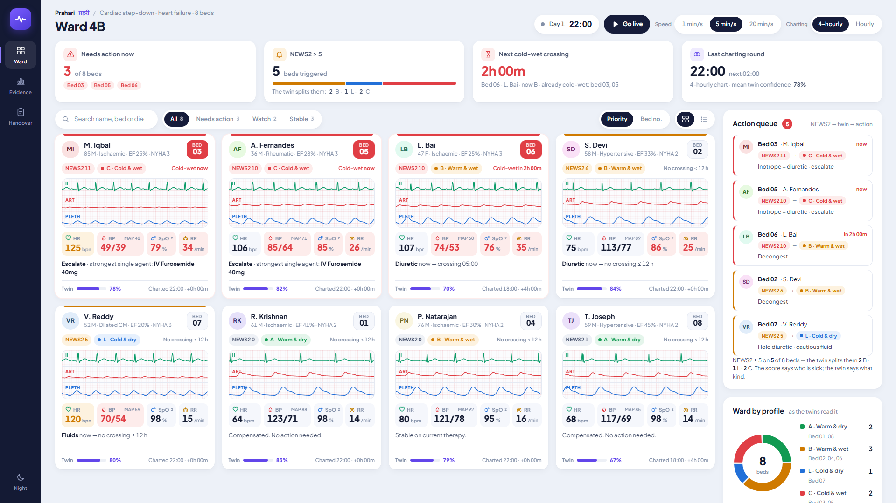
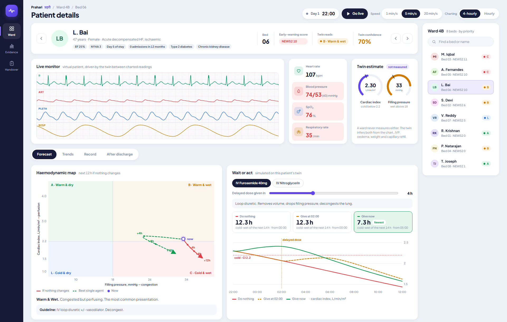
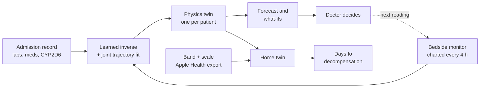
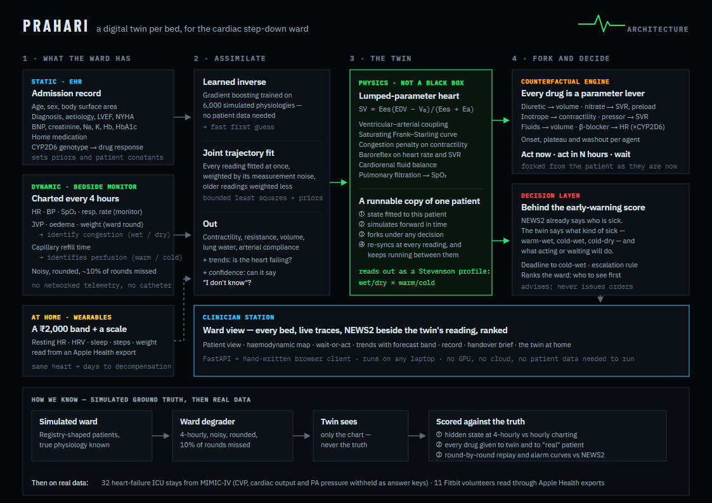
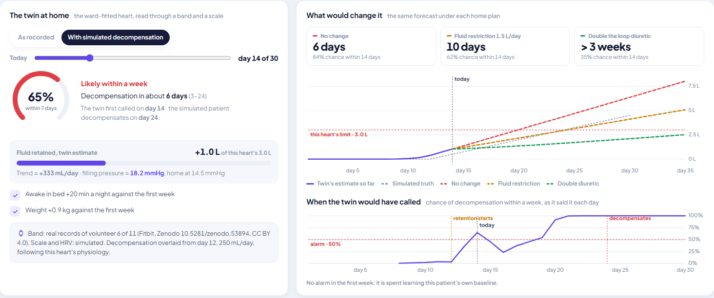

# Prahari

A digital twin per bed for heart-failure wards, and for the patient after they go home.

[](https://github.com/Madhav0414/Coder10x_SOA/actions/workflows/tests.yml)


*Prahari (प्रहरी): the one who keeps watch.*



| | |
|---|---|
| **Team** | Coder10x: Madhav Sharma |
| **College** | SOA |
| **Condition** | Chronic heart failure |
| **Predicts** | Decompensation: hours ahead on the ward, days ahead at home |
| **Live demo** | `[LIVE DEMO LINK]` (free hosting: after a quiet spell the first visit takes about a minute) |
| **Demo video** | [youtu.be/CLIIcmpJKTY](https://youtu.be/CLIIcmpJKTY) |
| **Architecture** | [docs/architecture.pdf](docs/architecture.pdf) |
| **Slides** | [docs/presentation.pdf](docs/presentation.pdf) |
| **License** | [MIT](LICENSE) |

## Problem statement

On an Indian cardiac step-down ward at night, one doctor covers every bed and
vitals are charted by hand every four hours. India has roughly one intensivist
for every 75 ICU beds, and the wards below the ICU get less. Heart-failure
patients there deteriorate over hours: slowly enough to act on, quietly enough to
miss between rounds. In the Trivandrum Heart Failure Registry, 30.8% of patients
admitted with acute heart failure were dead within a year.

The ward already runs an early-warning score, NEWS2. It is good at telling you
**who** is sick. It cannot tell you **what kind** of sick, and in heart failure
that decides the drug:

- a **cold-wet** patient (congested and underperfused) needs an inotrope, a
  diuretic and escalation;
- a **cold-dry** patient is hypotensive and tachycardic, so NEWS2 fires on them
  too, and the reflex diuretic makes them worse.

## Healthcare use case

**Who uses it:** the doctor and nurses covering a cardiac step-down ward
overnight, and the heart-failure clinic that follows patients after discharge.

**When:** the 2 a.m. question between charting rounds, *can this wait until the
morning?*, and at home, the slow slide back into decompensation that usually goes
unnoticed until the patient is readmitted.

**What changes:** NEWS2 says who is sick. Prahari adds what kind of sick (the
Nohria–Stevenson profile), how long until the patient crosses into the worst
profile, and what each guideline option does if given now, later or not at all.
At home, the same twin turns a week of band and scale data into "about six days
to decompensation" and shows what a fluid restriction or a bigger diuretic dose
would buy, early enough to change the plan by phone.

It sits behind NEWS2, not in place of it. It advises; it never issues orders.

## What it does

- Fits a physiological twin of each patient from what the ward already charts,
  and keeps it running between readings.
- Places every patient on the **Nohria–Stevenson map** (warm/cold × wet/dry),
  including cardiac index and filling pressure, which no ward instrument measures.
- Forecasts when the patient will reach the cold-wet profile if nothing changes.
- Compares every guideline option **given now, given later, or not at all**.
- After discharge, reads the same heart through a **wrist band and a bathroom
  scale** and forecasts the days left before decompensation.
- Writes a shift handover from the twins' state. Every figure in it is computed.



## Quick start

Python 3.10 or newer. No GPU, no API keys.

```bash
pip install -r requirements.txt
python run.py                         # opens http://127.0.0.1:8600
```

The first start takes about ten seconds to train the inverse model; after that it
is cached. **Space** runs the ward clock, **← →** step one charting round, **Esc**
goes back to the ward. Click any bed to open it.

Optional, for the real-data parts:

```bash
python scripts/fetch_data.py          # MIMIC-IV demo + Fitbit data (~100 MB, checksummed)
python -m pytest                      # 69 tests
python scripts/run_experiments.py     # regenerates docs/results.md (~20 min)
python scripts/build_docs.py          # rebuilds the PDFs from those results
```

Without the datasets the app still runs, and labels the home data as simulated.

To put it online, `render.yaml` deploys it on Render's free plan: New → Blueprint → this repository.

## How it works



The full diagram is in [docs/architecture.pdf](docs/architecture.pdf):



### Data

| Stream | Contents | Code |
|---|---|---|
| Static: the record | Age, sex, body size; diagnosis, aetiology, LVEF, NYHA class, prior admissions; BNP, creatinine, sodium, potassium, haemoglobin, HbA1c; home medication; CYP2D6 genotype | `prahari/data/ward.py` |
| Dynamic: the ward | Heart rate, blood pressure, SpO₂ and respiratory rate from the bedside monitor as charted (every 4 h, or hourly); ward scale weight; JVP, oedema and capillary refill from the round. With noise, rounding and ~10% of rounds missed | `prahari/data/ward.py` |
| Dynamic: home | Resting heart rate, HRV, sleep, time awake in bed and steps from a band; weight from a scale; read from an Apple Health `export.xml` | `prahari/data/wearables.py` |

| Source | Used for | License |
|---|---|---|
| Simulated ward, patient mix shaped on the Trivandrum HF Registry | The app's eight beds; experiments 1–3 | — |
| [MIMIC-IV Clinical Database Demo v2.2](https://physionet.org/content/mimic-iv-demo/2.2/) | 32 real heart-failure ICU stays | ODbL 1.0 |
| [Crowd-sourced Fitbit datasets](https://zenodo.org/records/53894) | 11 real volunteers' band records (HRV and weight are simulated; the data has neither) | CC BY 4.0 |

The datasets are downloaded by `scripts/fetch_data.py` and are not part of the repository.

### AI/ML model

Prahari is a hybrid: a mechanistic physiology model, fitted to each patient by
machine learning and statistical inference. There is no language model anywhere.

- **The twin** (`prahari/core/cardiac.py`) is a lumped-parameter model of the
  heart and circulation. Stroke volume comes from ventricular–arterial coupling,
  `SV = Ees·(EDV − V0)/(Ees + Ea)` with `Ea = HR·SVR/1000`, so a baroreflex
  tachycardia raises afterload: the reason a failing heart gets worse as it speeds
  up. Add a saturating Frank–Starling curve, a congestion penalty on
  contractility, cardiorenal urine output and pulmonary filtration. Its two main
  outputs are the Stevenson axes: filling pressure (wet above 18 mmHg) and
  cardiac index (cold below 2.2 L/min/m²).
- **Fitting** (`prahari/models/estimator.py`): a gradient-boosted learned inverse,
  trained on 6,000 simulated physiologies, makes a first guess from one reading;
  a joint least-squares fit then uses every reading at once, weighted by its
  noise, and returns the current state plus its trends. Between readings the twin
  keeps simulating, and its confidence falls with every hour it extrapolates.
- **What-ifs** (`prahari/core/interventions.py`): seven drugs as levers on the
  model (diuretic → volume, nitrate → resistance and preload, inotrope →
  contractility, and so on), each with onset, plateau and washout, and the
  beta-blocker scaled by CYP2D6 phenotype.
- **The home twin** (`prahari/core/home.py`): the ward-fitted heart run at its
  daily steady state. Retained fluid becomes filling pressure and lung water, and
  those become what a band and scale see. A grid posterior over when retention
  started and how fast it runs gives the days left to decompensation, under each
  home plan.



### Technical stack

| | |
|---|---|
| Model and experiments | Python 3.10+, NumPy, SciPy (`solve_ivp`, `least_squares`), scikit-learn (`HistGradientBoostingRegressor`), pandas |
| API | FastAPI, Uvicorn |
| Front end | Plain HTML, CSS and JavaScript, no framework; canvas waveforms, hand-written SVG charts |
| Tests | pytest, httpx; GitHub Actions on every push |
| Documents | Slides and diagram written in HTML, printed to PDF by headless Chromium |

## Results

All numbers are produced by `scripts/run_experiments.py`; the full write-up,
with every table, is [docs/results.md](docs/results.md).

| Question | Result |
|---|---|
| Stevenson profile from a 4-hourly chart (simulated ward) | 83% correct; 96% with hourly readings |
| Drug-effect direction, twin vs true patient | 98.9% of 3,080 comparisons, r = 0.97 |
| Decision regret vs "diuretic whenever NEWS2 fires" | 0.005 vs 0.047 |
| As an alarm, vs NEWS2 at the same alarm burden | Not better. It sits behind the score |
| Real ICU stays (MIMIC-IV demo, 32) | Moves with withheld CVP, cardiac index and PA pressure (r 0.30 / 0.62 / 0.53), but reads patients as less sick than they are |
| Home, band + scale | 91 of 91 simulated decompensations caught, median 6 days ahead, 0.5% false alarms |
| Home, band only | 61 of 91, 4 days ahead, but 5.2% false alarms (3.9% on real volunteers) |

The drug-effect results are checked against the model's own pharmacology, so
they show the twin recovers the patient's state, not that its drug effect sizes
are right for real patients; on real ICU data they are not yet calibrated. What
went wrong along the way, and how it was fixed, is in [docs/lessons.md](docs/lessons.md).

## Limitations

- The simulated results are an upper bound: ground truth comes from the same
  physiology the twin uses.
- On real ICU patients the twin reads them as less sick than they are, and its
  drug effect sizes are uncalibrated. The next step is the full MIMIC-IV database
  with a proper train/test split, then a silent shadow run on a ward.
- At home, the band channels are real but HRV, weight and the decompensation are
  simulated. The twin treats day-to-day noise as independent, so slow real-world
  wander reads as slow retention. The band-only alarm is not yet usable alone.
- Single doses only (no infusion titration); left heart only.
- Not a medical device. It ranks and explains; the clinician decides.

## Project layout

```
run.py                  start the app
prahari/
  core/                 the twin: cardiac model, twin, drugs, Stevenson profiles,
                        triage, home twin, handover, meals and glucose
  data/                 simulated ward, MIMIC-IV loader, wearables (Apple Health)
  models/               learned inverse + joint fit; NEWS2
  pipeline.py           fitting a ward; the simulated experiments
  real_validation.py    experiments on MIMIC-IV
  home_validation.py    experiments on the home twin
  api.py                HTTP API
web/                    the app: HTML, CSS, JS, fonts
scripts/                fetch data, run experiments, build the PDFs
tests/                  69 tests
docs/                   results, slides, architecture, screenshots
```

## License and references

MIT. Bundled fonts (Plus Jakarta Sans, Barlow Condensed, IBM Plex, Noto Sans
Devanagari) are under the SIL Open Font License.

1. Harikrishnan S et al. One-year mortality and readmissions after acute heart failure: Trivandrum Heart Failure Registry. *Am Heart J* 2017.
2. Nohria A et al. Clinical assessment identifies hemodynamic profiles that predict outcomes in heart failure. *JACC* 2003.
3. Chioncel O et al. Congestion and perfusion profiles in acute heart failure: ESC-EORP-HFA Long-Term Registry. *Eur J Heart Fail* 2019.
4. Royal College of Physicians. National Early Warning Score (NEWS) 2. 2017.
5. Hernández G et al. Peripheral perfusion vs lactate-targeted resuscitation: ANDROMEDA-SHOCK. *JAMA* 2019.
6. Wong A et al. External validation of a widely implemented proprietary sepsis prediction model. *JAMA Intern Med* 2021.
7. Indian Society of Critical Care Medicine: intensivist and ICU-bed capacity in India.
8. Johnson A et al. MIMIC-IV Clinical Database Demo (v2.2). PhysioNet, 2023.
9. Goldberger A et al. PhysioBank, PhysioToolkit, and PhysioNet. *Circulation* 2000.
10. Furberg R et al. Crowd-sourced Fitbit datasets 03.12.2016–05.12.2016. Zenodo, 10.5281/zenodo.53894.
